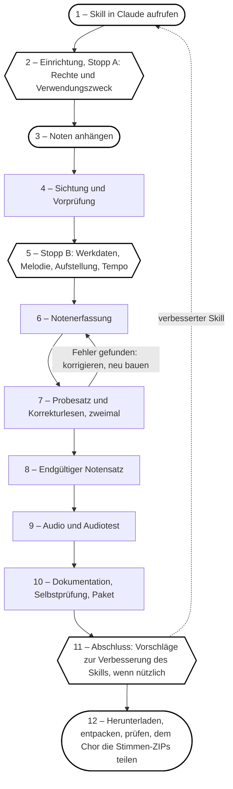

<p><a href="https://vbth.github.io/choir-practice/"></a></p>

# choir-practice Skill

<p><picture><source media="(prefers-color-scheme: dark)" srcset="docs/img/header-dark.png"></picture></p>

[English](README.md) | Deutsch

## Deine Chorstimme. Deine Noten.<br>Überall lesen, hören und singen.

**Dokumentation eines agentischen KI-Musik-Workflows und -Skills entwickelt für und mit Claude Code als privates Code-Experiment.**

Es handelt sich ausschließlich um einen „Proof of Concept“. Aus Chornoten entsteht am Ende ein „KI-⁠geprüftes“ ZIP, in dem sich für jede Stimme 10 Aufnahmen zum Üben befinden.

**Website mit Beispielpaket und Player:** https://vbth.github.io/choir-practice/

**Beispielpaket (ZIP, aus dem Release):** [Alle meine Entchen](https://github.com/vbth/choir-practice/releases/download/v1.0.0/Chor_Uebungen_Alle_meine_Entchen.zip)

**Inhalt**

[1. Überblick – Was macht der Skill?](#1-überblick--was-macht-der-skill)<br>
[2. Ergebnis – Was kommt heraus?](#2-ergebnis--was-kommt-heraus)<br>
[3. Ablauf – Welche Schritte gibt es?](#3-ablauf--welche-schritte-gibt-es)<br>
[4. Audio-Mix – Wie werden die Aufnahmen gemischt?](#4-audio-mix--wie-werden-die-aufnahmen-gemischt)<br>
[5. KI-Kennzeichnung – Wie werden KI-Inhalte markiert?](#5-ki-kennzeichnung--wie-werden-ki-inhalte-markiert)<br>
[6. Grenzen – Was kann er nicht?](#6-grenzen--was-kann-er-nicht)<br>
[7. Voraussetzungen – Was wird benötigt?](#7-voraussetzungen--was-wird-benötigt)<br>
[8. Rechte – Was fragt der Skill ab?](#8-rechte--was-fragt-der-skill-ab)<br>
[9. Lizenz – Was ist erlaubt?](#9-lizenz--was-ist-erlaubt)<br>
[10. Entwicklung – Wie arbeitet man weiter?](#10-entwicklung--wie-arbeitet-man-weiter)

## 1. Überblick – Was macht der Skill?

**Eingang:** Noten als PDF, Foto, Scan oder Export aus einem Notensatzprogramm.

**Ergebnis:** ein ZIP mit
- Übe-Audio (MP3) und MIDI je Stimme: allein, mit Begleitung, im Chor, plus Tutti; in Chor- und Klavierklang; normal und verlangsamt
- Tags in jeder MP3 (Titel mit Stück, Nummer und Inhalt, Album je Stimme und Klang, Spurnummer, Komposition, KI-Hinweis) und ein Albumcover: eines je Stück, für alle Stimmen gleich, Farben aus Tonart, Tongeschlecht, Tempo und Takt abgeleitet, Lesbarkeit des Titels geprüft
- einer fertigen ZIP-Datei je Stimme, einer Anleitung für die Chorleitung, einem Prüf- und einem Korrekturprotokoll

> *„Die Audio-Dateien enthalten jeden Ton und jeden Einsatz mechanisch exakt, so wie er notiert ist, ohne Interpretation.“*
>
> — Claude

## 2. Ergebnis – Was kommt heraus?
MP3-Titel, Dateinamen, PDFs und Protokolle folgen der Sprache der Unterhaltung (Deutsch und Englisch eingebaut, siehe [README.md](README.md)). Ein ZIP, benannt wie der oberste Ordner:

```text
Chor_Uebungen_<Titel>/
├─ 1_Noten/
│  ├─ 1_Noten_<Titel>_Scan.pdf
│  ├─ 2_Noten_<Titel>.pdf
│  ├─ 3_MusicXML_<Titel>_Chor.musicxml
│  ├─ 4_MusicXML_<Titel>_Klavier.musicxml
│  └─ 5_MIDI_<Titel>/
│     ├─ S_MIDI_<Titel>/           (je Stimme: S, A, T, B; zehn Dateien)
│     └─ Tutti_MIDI_<Titel>/       (Chor und Klavier)
├─ 2_Ueben/
│  ├─ 1_Uebersicht.pdf
│  ├─ 2_Anleitung.pdf
│  └─ S_Ueben_<Titel>.zip          (je Stimme eine ZIP-Datei, fertig zum Weitergeben)
│        ├─ 1_S_Anleitung.pdf
│        ├─ 2_S_Noten_<Titel>.pdf
│        ├─ 3_S_Audio_Chorklang_<Titel>/     (sechs MP3: allein, mit Klavier, jeweils langsam und normal; eigene Stimme lauter; alle gleich laut)
│        └─ 4_S_Audio_Klavierklang_<Titel>/  (dieselben sechs)
├─ 3_Dokumentation/
│  ├─ 1_README_<Titel>
│  ├─ 2_Pruefprotokoll_<Titel>
│  ├─ 3_Korrekturprotokoll_<Titel>
│  └─ 4_Session_Handoff_<Titel>.md
└─ 4_Werkzeuge/
   ├─ 1_Projektdaten_<Titel>/                 (score.json, docs.json, layout.json, mixes.json)
   └─ 2_SKILL_choir_practice_v<Version>/      (choir_practice.skill, README.md, session_handoff.md)
```

## 3. Ablauf – Welche Schritte gibt es?

Besteht eine Prüfung nicht, behebt Claude den Fehler und prüft erneut, bis zu dreimal. Klappt es dann immer noch nicht, hält Claude an und sagt dir, was fehlschlägt, woran es liegt und welche Möglichkeiten du hast.

| Nr. | Schritt | Wer tut was | Prüfung am Ende |
|--:|---|---|---|
| 1 | Aufruf | Du rufst den Skill auf. | – |
| 2 | Einrichtung, Stopp A | Claude prüft die Werkzeuge und fragt, falls etwas fehlt, ob die getesteten oder die neuesten Paketversionen installiert werden sollen. Dann gibst du an, wie die Rechte stehen und wofür das Material gedacht ist. | Alle Werkzeuge in Ordnung? |
| 3 | Noten anhängen | Du hängst die Noten an. | – |
| 4 | Sichtung | Claude liest die Seiten, prüft die Scanqualität und gleicht mit deiner Rechte-Antwort ab. | Struktur verstanden, Umfang angekündigt? |
| 5 | Stopp B | Du bestätigst Titel, Melodiestimme, Aufstellung und Tempo. | – |
| 6 | Notenerfassung | Claude überträgt die Noten in Daten und MusicXML. | Noten ohne Fehler aufgebaut? |
| 7 | Korrekturlesen | Claude setzt einen Probesatz und vergleicht ihn zweimal mit der Vorlage: erst Töne und Rhythmus, dann Text. | Beide Durchgänge sauber, Befunde geklärt? Sonst zurück zu Schritt 6. |
| 8 | Endgültiger Notensatz | Claude setzt die korrigierten Noten in DIN A4 mit Titelblatt. | Lesbar, Seiten gefüllt, angesehen? |
| 9 | Audio | Claude erzeugt MP3 und MIDI mit Tags und Albumcover und prüft sie technisch (Dauer, Lücken, Übersteuerung, Lautstärke, Stereo). | Alle Dateien da, Stichprobe gemacht? |
| 10 | Paket | Claude schreibt die Dokumente, prüft sich selbst und packt das ZIP mit den Stimmen-ZIPs. | verify.py besteht, ZIPs getestet? |
| 11 | Abschluss | Claude schlägt Verbesserungen für den Skill vor, wenn nützlich. Du entscheidest. | – |
| 12 | Herunterladen | Du lädst das ZIP herunter, entpackst und prüfst es und teilst die Stimmen-ZIPs mit dem Chor. | – |

## 4. Audio-Mix – Wie werden die Aufnahmen gemischt?
Jede Stimme bekommt ihren eigenen Mix; die eigene Stimme liegt immer in der Mitte. Die anderen Stimmen sind nach der Chorsitzordnung im Stereobild verteilt, der Kopfhörer bildet also die Reihe nach. Mit Kopfhörern klingt es am besten.

- **Allein:** nur die eigene Stimme.
- **Mit Begleitung:** eigene Stimme, Melodie −4 dB, Klavierbegleitung aller Stimmen −12 dB.
- **Im Chor:** Nachbarn links und rechts −7 dB, übernächste Stimme −9 dB, die übrigen −12 dB.
- **Tutti:** alle Stimmen gleich laut.
- Jede Aufnahme beginnt mit dem Anfangston der Stimme, danach eine kurze Pause. Allein und mit Begleitung gibt es auch langsamer (Standard 75 % Tempo, einstellbar).
- Lautheit −19 LUFS, leichter Raumhall; die MIDI-Dateien tragen dieselben Lautstärke- und Pan-Werte.
- Das Modul „Üben“ der Website zeigt die Mixe live am Kopfhörer (Punktgröße = Pegel, Position = links/rechts). Die Übersicht, die für jedes Stück erzeugt wird (`2_Ueben/1_Uebersicht.pdf`), zeigt dieselben Mixe.

## 5. KI-Kennzeichnung – Wie werden KI-Inhalte markiert?
Alles, was der Skill erzeugt, ist als KI-generiert gekennzeichnet: das EU-Label „AI“ und der Hinweis „KI-generiert. Nutzung auf eigene Verantwortung.“ in der Fußzeile jedes PDFs, derselbe Hinweis in den Metadaten von MP3, MIDI, MusicXML und PDF. Das Label folgt den Symbolen der Europäischen Kommission zur Kennzeichnung KI-generierter Inhalte (siehe [`THIRD_PARTY_NOTICES.md`](https://github.com/vbth/choir-practice/blob/main/choir-practice/THIRD_PARTY_NOTICES.md)).

## 6. Grenzen – Was kann er nicht?
- Claude hört das Audio nicht; es wird technisch geprüft (Dauer gegen das MIDI, Lücken, Übersteuerung, Lautstärke, Stereo). Klang und Geschmack werden nicht beurteilt.
- Vorzeichen und Rhythmus werden aus Bildausschnitten gelesen und zweimal korrigiert, nicht gemessen.
- Wiederholungen, Klammern und Spielreihenfolge sind nur mit kleinen Testnoten erprobt; echte Stücke stichprobenartig prüfen. D.C./D.S./Coda werden nicht als Zeichen gesetzt.
- Nur DIN A4. US Letter wird aktuell nicht unterstützt.

## 7. Voraussetzungen – Was wird benötigt?
Python mit den Paketen aus [`scripts/requirements-stable.txt`](https://github.com/vbth/choir-practice/blob/main/choir-practice/scripts/requirements-stable.txt), FluidSynth, ffmpeg, poppler und eine Soundfont (ein Ersatz wird verwendet und gemeldet). Zu Beginn prüft der Skill die Installation (`setup.sh --check`). Fehlt etwas oder weicht etwas ab, listet er auf, was er installieren würde, und fragt: die **getesteten Versionen** (empfohlen, aufgeführt in [`scripts/requirements-stable.txt`](https://github.com/vbth/choir-practice/blob/main/choir-practice/scripts/requirements-stable.txt)) oder die **neuesten Versionen**. Die verwendeten Versionen stehen im Prüfprotokoll; neueste Versionen sind als nicht getestet gekennzeichnet.

## 8. Rechte – Was fragt der Skill ab?
Der Skill gibt keine Rechtsberatung und räumt keine Rechte ein. Er fragt, ob die Noten gemeinfrei, lizenziert, eigenes Werk oder unklar sind und ob sie zum Proben oder kommerziell genutzt werden, und vermerkt die Antwort in der README. Unklare Rechte bei kommerzieller Nutzung bekommen eine deutliche Warnung. Die kommerzielle Nutzung des Skills selbst braucht eine Lizenz (siehe 9); die Lizenz sagt nichts über die Rechte an den Noten.

## 9. Lizenz – Was ist erlaubt?
PolyForm Noncommercial License 1.0.0 ([`LICENSE.md`](LICENSE.md)), frei für nichtkommerzielle Nutzung. Komponenten Dritter: [`THIRD_PARTY_NOTICES.md`](https://github.com/vbth/choir-practice/blob/main/choir-practice/THIRD_PARTY_NOTICES.md).

## 10. Entwicklung – Wie arbeitet man weiter?
[`SKILL.md`](https://github.com/vbth/choir-practice/blob/main/choir-practice/SKILL.md) Anweisungen · [`references/`](https://github.com/vbth/choir-practice/tree/main/choir-practice/references) Formate und Leitfäden · [`assets/`](https://github.com/vbth/choir-practice/tree/main/choir-practice/assets) Sprachpakete und Vorlagen · [`scripts/`](https://github.com/vbth/choir-practice/tree/main/choir-practice/scripts) Werkzeuge · [`CHANGELOG.md`](CHANGELOG.md).

**Die Versionierung läuft über GitHub und diese Markdown-Dateien:**
- [`choir-practice/VERSION`](https://github.com/vbth/choir-practice/blob/main/choir-practice/VERSION) ist die einzige Quelle der Versionsnummer (SemVer). [`README.md`](README.md), [`README.de.md`](README.de.md) und [`CHANGELOG.md`](CHANGELOG.md) im Hauptordner des Repos sind die Dokumentation; der Skill-Ordner enthält nur Kopien.
- Änderungen während der Arbeit als Stichpunkte unter `## Unreleased` in [`CHANGELOG.md`](CHANGELOG.md) eintragen.
- Release: `python3 choir-practice/scripts/release.py choir-practice --repo . --out ../release --bump patch|minor|major` erhöht `VERSION`, verschiebt die Stichpunkte in einen datierten Abschnitt, setzt das Datum der Fußzeile in beiden READMEs und baut `choir-practice.skill`. Danach committen, Tag `vX.Y.Z` setzen und den Tag pushen.
- Der Workflow [`.github/workflows/checks.yml`](https://github.com/vbth/choir-practice/blob/main/.github/workflows/checks.yml) läuft bei jedem Pull Request: Lint, Kompilieren, Sprachpakete und Vorlagen, Website passend zu [`site/build_site.py`](https://github.com/vbth/choir-practice/blob/main/site/build_site.py), README-Kopien im Skill-Ordner gleich.
- Der Workflow [`.github/workflows/release.yml`](https://github.com/vbth/choir-practice/blob/main/.github/workflows/release.yml) prüft, ob Tag und `VERSION` übereinstimmen, und veröffentlicht ein GitHub-Release mit der `.skill`-Datei und dem Changelog-Eintrag.
- Die Seite in [`docs/`](https://github.com/vbth/choir-practice/tree/main/docs) entsteht mit `python3 site/build_site.py` und wird über GitHub Pages ausgeliefert (Branch `main`, Ordner `/docs`). Vorschaubilder, Render-Test und Regeln: [`site/README.md`](https://github.com/vbth/choir-practice/blob/main/site/README.md).
- Dependabot ([`.github/dependabot.yml`](https://github.com/vbth/choir-practice/blob/main/.github/dependabot.yml)) schlägt monatlich Updates vor: für die festgelegten Paketversionen in [`scripts/requirements-stable.txt`](https://github.com/vbth/choir-practice/blob/main/choir-practice/scripts/requirements-stable.txt) (nur Minor und Patch, gebündelt, höchstens zwei offene PRs) und für die GitHub Actions. Die CI testet die Skill-Pipeline nicht mit diesen Paketen: Vor dem Mergen eines Python-PRs die ganze Pipeline mit den neuen Versionen durchlaufen lassen, dann [`CHANGELOG.md`](CHANGELOG.md) ergänzen; die neuen Versionen gelten erst im nächsten Release.
- Zum Weiterentwickeln des Skills in einem neuen Chat [`choir-practice/session-handoff.md`](https://github.com/vbth/choir-practice/blob/main/choir-practice/session-handoff.md) anhängen (offene Punkte und Erkenntnisse der aktuellen Version).

<a href="https://github.com/vbth/choir-practice"><picture><source media="(prefers-color-scheme: dark)" srcset="https://raw.githubusercontent.com/vbth/choir-practice/main/docs/img/github-mark-dark.svg"></picture></a> choir-practice – KI-Musik-Workflow/-⁠Skill für Claude.

<a href="https://vbth.github.io/choir-practice/"><picture><source media="(prefers-color-scheme: dark)" srcset="https://raw.githubusercontent.com/vbth/choir-practice/main/docs/img/ai-basic-dark.svg"></picture></a> 2026-10-29 KI-generiert. Nutzung auf eigene Verantwortung.

