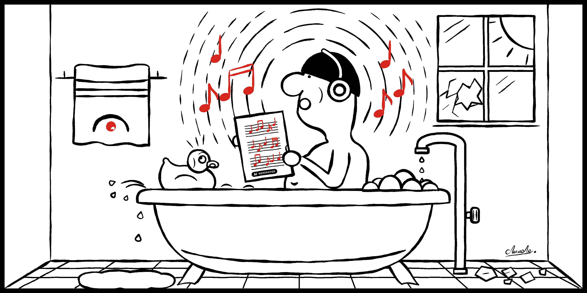
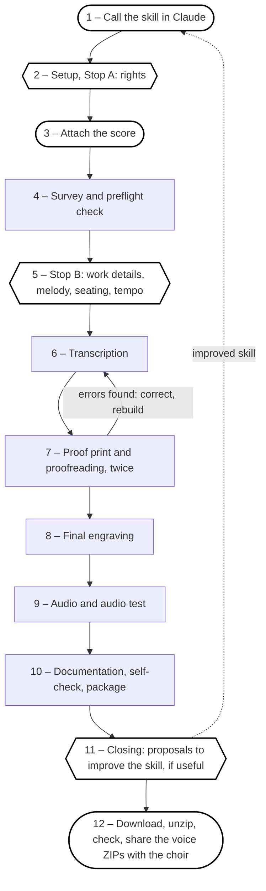

<p><a href="https://vbth.github.io/choir-practice/en/"></a></p>

# choir-practice Skill

<p><picture><source media="(prefers-color-scheme: dark)" srcset="docs/img/header-dark.png"></picture></p>

English | [Deutsch](README.de.md)

## Your voice. Your notes.<br>Read, listen, practise anywhere.

**Documentation of an agentic AI music workflow and skill developed for and with Claude Code as a private code experiment.**

This is a “proof of concept” only. In the end, a choir score becomes an “AI-checked” ZIP containing 10 practice recordings for every voice.

**Website with example pack and player:** https://vbth.github.io/choir-practice/

**Example pack (ZIP, from the release):** [All My Ducklings](https://github.com/vbth/choir-practice/releases/download/v1.0.0/Choir_Practice_All_My_Ducklings.zip)

**Contents**

[1. Overview – What does it do?](#1-overview--what-does-it-do)<br>
[2. Result – What comes out?](#2-result--what-comes-out)<br>
[3. Workflow – Which steps are there?](#3-workflow--which-steps-are-there)<br>
[4. Audio mix – How are the recordings mixed?](#4-audio-mix--how-are-the-recordings-mixed)<br>
[5. AI marking – How is AI content marked?](#5-ai-marking--how-is-ai-content-marked)<br>
[6. Limits – What can’t it do?](#6-limits--what-cant-it-do)<br>
[7. Requirements – What is needed?](#7-requirements--what-is-needed)<br>
[8. Rights – What does the skill ask?](#8-rights--what-does-the-skill-ask)<br>
[9. Licence – What is allowed?](#9-licence--what-is-allowed)<br>
[10. Development – How to continue?](#10-development--how-to-continue)

## 1. Overview – What does it do?

**In:** the score as PDF, photo, scan or export from notation software.

**Out:** one ZIP with
- practice audio (MP3) and MIDI per voice: solo, with accompaniment, in the choir, plus tutti; in choir and piano sound; normal and slowed down
- tags in every MP3 (title with piece, number and content, album per voice and sound, track number, composer, AI note) and an album cover: one per piece, the same for all voices, colours derived from key, mode, tempo and metre, title legibility checked
- one ready-made ZIP per voice, a guide for the choir director, a check log and a correction log

> *“The audio files contain every note and every entry mechanically exact, as written, without interpretation.”*
>
> — Claude

## 2. Result – What comes out?
MP3 titles, file names, PDFs and logs follow the language of the conversation (German and English built in, see [README.de.md](README.de.md)). One ZIP, named like the top folder:

```text
Choir_Practice_<Title>/
├─ 1_Scores/
│  ├─ 1_Score_<Title>_Scan.pdf
│  ├─ 2_Score_<Title>.pdf
│  ├─ 3_MusicXML_<Title>_Choir.musicxml
│  ├─ 4_MusicXML_<Title>_Piano.musicxml
│  └─ 5_MIDI_<Title>/
│     ├─ S_MIDI_<Title>/           (one per voice: S, A, T, B; ten files)
│     └─ Tutti_MIDI_<Title>/       (choir and piano)
├─ 2_Practice/
│  ├─ 1_Overview.pdf
│  ├─ 2_Guide.pdf
│  └─ S_Practice_<Title>.zip       (one ZIP per voice, ready to pass on)
│        ├─ 1_S_Guide.pdf
│        ├─ 2_S_Score_<Title>.pdf
│        ├─ 3_S_Audio_Choir_Sound_<Title>/   (six MP3: solo, with piano, each slow and normal; own voice louder; all voices equal)
│        └─ 4_S_Audio_Piano_Sound_<Title>/   (the same six)
├─ 3_Documentation/
│  ├─ 1_README_<Title>
│  ├─ 2_Check_Log_<Title>
│  ├─ 3_Correction_Log_<Title>
│  └─ 4_Session_Handoff_<Title>.md
└─ 4_Tools/
   ├─ 1_Project_Data_<Title>/                 (score.json, docs.json, layout.json, mixes.json)
   └─ 2_SKILL_choir_practice_v<Version>/      (choir_practice.skill, README.md, session_handoff.md)
```

## 3. Workflow – Which steps are there?

If a check fails, Claude fixes the problem and checks again, up to three times. If it still fails, Claude stops and tells you what went wrong, why, and what your options are.

| No. | Step | Who does what | Check at the end |
|--:|---|---|---|
| 1 | Call | You call the skill. | – |
| 2 | Setup, Stop A | Claude checks the tools and, if something is missing, asks whether to install the tested or the newest package versions. Then you state the rights status. | All tools ok? |
| 3 | Attach score | You attach the score. | – |
| 4 | Survey | Claude reads the pages, checks the scan quality and compares it with your rights answer. | Structure understood, scope announced? |
| 5 | Stop B | You approve title, melody voice, seating and tempo. | – |
| 6 | Transcription | Claude turns the score into data and MusicXML. | Score builds without errors? |
| 7 | Proofreading | Claude engraves a proof print and compares it twice with the source: pitches and rhythm first, then lyrics. | Both passes clean, findings resolved? Otherwise back to step 6. |
| 8 | Final engraving | Claude engraves the corrected DIN A4 score with a cover page. | Readable, pages filled, looked at? |
| 9 | Audio | Claude creates MP3 and MIDI with tags and album cover and checks them technically (duration, gaps, clipping, loudness, stereo). | All files present, spot check done? |
| 10 | Package | Claude writes the documents, checks itself and packs the ZIP with the voice ZIPs. | verify.py passes, ZIPs tested? |
| 11 | Closing | Claude proposes improvements to the skill if useful. You decide. | – |
| 12 | Download | You download the ZIP, unzip it, check it and share the voice ZIPs with the choir. | – |

## 4. Audio mix – How are the recordings mixed?
Each voice gets its own mix; the own voice always sits centred. The other voices are panned by the choir seating, so the headphones recreate the row. It sounds best on headphones.

- **Solo:** own voice only.
- **With accompaniment:** own voice, melody −4 dB, piano accompaniment of all parts −12 dB.
- **In the choir:** neighbours left and right −7 dB, next-but-one −9 dB, the rest −12 dB.
- **Tutti:** all voices at equal level.
- Every recording starts with the voice’s starting note, then a short pause. Solo and with accompaniment also exist at a slower tempo (default 75 %, adjustable).
- Loudness −19 LUFS, light room reverb; the MIDI files carry the same volume and pan values.
- The "Practice" module of the website shows the mixes live on a headphone graphic (dot size = level, position = left/right). The overview PDF generated for every piece (`2_Practice/1_Overview.pdf`) shows the same mixes.

## 5. AI marking – How is AI content marked?
Everything the skill generates is marked as AI-generated: the EU label "AI" and the note "AI-generated. Use at your own risk." in the footer of every PDF, and the same note in the metadata of MP3, MIDI, MusicXML and PDF. The label follows the European Commission's icons for labelling AI-generated content (see [`THIRD_PARTY_NOTICES.md`](https://github.com/vbth/choir-practice/blob/main/choir-practice/THIRD_PARTY_NOTICES.md)).

## 6. Limits – What can’t it do?
- Claude does not hear the audio; it is tested technically (duration against the MIDI, gaps, clipping, loudness, stereo). Sound and taste are not judged.
- Accidentals and rhythm are read from image crops and proofread twice, not measured.
- Repeats, endings and playback order are tested on small trial scores only; spot-check real pieces. D.C./D.S./coda are not engraved as signs.
- DIN A4 only. US Letter is currently not supported.

## 7. Requirements – What is needed?
Python with the packages from [`scripts/requirements-stable.txt`](https://github.com/vbth/choir-practice/blob/main/choir-practice/scripts/requirements-stable.txt), FluidSynth, ffmpeg, poppler and a soundfont (a fallback is used and reported). At the start the skill checks the installation (`setup.sh --check`). If something is missing or different, it lists what it would install and asks: the **tested versions** (recommended, listed in [`scripts/requirements-stable.txt`](https://github.com/vbth/choir-practice/blob/main/choir-practice/scripts/requirements-stable.txt)) or the **newest versions**. The versions used are recorded in the check log; newest versions are marked as not tested.

**Sound.** The audio is rendered with a soundfont: MuseScore General (installed by `setup.sh`, the default) or, on request, **GeneralUser GS 2.0.3**, which is included in the skill (`assets/soundfonts/`). GeneralUser GS is by S. Christian Collins ([original source](https://www.schristiancollins.com/generaluser.php), [repository](https://github.com/mrbumpy409/GeneralUser-GS)) and may be used for private and commercial music production under its own [licence](https://github.com/vbth/choir-practice/blob/main/choir-practice/assets/soundfonts/GeneralUser-GS-LICENSE.txt). To fit the upload limit the skill carries it **compressed to the SF3 format** (Ogg Vorbis, 7 MB instead of 32 MB, lossy); presets and licence text are unchanged. Details in [`THIRD_PARTY_NOTICES.md`](https://github.com/vbth/choir-practice/blob/main/choir-practice/THIRD_PARTY_NOTICES.md).

## 8. Rights – What does the skill ask?
The skill gives no legal advice and grants no rights. It asks whether the score is public domain, licensed, your own work or unclear, and notes the answer in the README. The licence of the skill (see 9) says nothing about the rights to the score.

## 9. Licence – What is allowed?
PolyForm Noncommercial License 1.0.0 ([`LICENSE.md`](LICENSE.md)), free for non-commercial use. Third-party components: [`THIRD_PARTY_NOTICES.md`](https://github.com/vbth/choir-practice/blob/main/choir-practice/THIRD_PARTY_NOTICES.md).

## 10. Development – How to continue?
[`SKILL.md`](https://github.com/vbth/choir-practice/blob/main/choir-practice/SKILL.md) instructions · [`references/`](https://github.com/vbth/choir-practice/tree/main/choir-practice/references) formats and guides · [`assets/`](https://github.com/vbth/choir-practice/tree/main/choir-practice/assets) language packs and templates · [`scripts/`](https://github.com/vbth/choir-practice/tree/main/choir-practice/scripts) tools · [`CHANGELOG.md`](CHANGELOG.md).

**Versioning runs through GitHub and these Markdown files:**
- [`choir-practice/VERSION`](https://github.com/vbth/choir-practice/blob/main/choir-practice/VERSION) is the single source of the version number (SemVer). [`README.md`](README.md), [`README.de.md`](README.de.md) and [`CHANGELOG.md`](CHANGELOG.md) in the repository root are the documentation; the skill folder only holds copies.
- Write changes as bullets under `## Unreleased` in [`CHANGELOG.md`](CHANGELOG.md) while you work.
- Release: `python3 choir-practice/scripts/release.py choir-practice --repo . --out ../release --bump patch|minor|major` bumps `VERSION`, moves the bullets into a dated section, updates the date of the footer line in both READMEs and builds `choir-practice.skill`. Then commit, tag `vX.Y.Z` and push the tag.
- The workflow [`.github/workflows/checks.yml`](https://github.com/vbth/choir-practice/blob/main/.github/workflows/checks.yml) runs on every pull request: lint, compile, language packs and templates, website up to date with [`site/build_site.py`](https://github.com/vbth/choir-practice/blob/main/site/build_site.py), README copies in the skill folder in step.
- The workflow [`.github/workflows/release.yml`](https://github.com/vbth/choir-practice/blob/main/.github/workflows/release.yml) checks that tag and `VERSION` match and publishes a GitHub release with the `.skill` file and the changelog entry.
- The landing page in [`docs/`](https://github.com/vbth/choir-practice/tree/main/docs) is built by `python3 site/build_site.py` and published by GitHub Pages (branch `main`, folder `/docs`). Previews, render test and rules: [`site/README.md`](https://github.com/vbth/choir-practice/blob/main/site/README.md).
- Dependabot ([`.github/dependabot.yml`](https://github.com/vbth/choir-practice/blob/main/.github/dependabot.yml)) proposes updates monthly: for the pinned package versions in [`scripts/requirements-stable.txt`](https://github.com/vbth/choir-practice/blob/main/choir-practice/scripts/requirements-stable.txt) (minor and patch only, grouped, at most two open PRs) and for the GitHub Actions. CI does not run the skill pipeline with these packages: before merging a Python PR, run the whole pipeline with the new versions, then add to [`CHANGELOG.md`](CHANGELOG.md); the new versions only apply from the next release.
- To continue developing the skill in a new chat, attach [`choir-practice/session-handoff.md`](https://github.com/vbth/choir-practice/blob/main/choir-practice/session-handoff.md) (open points and lessons of the current version).

<a href="https://github.com/vbth/choir-practice"><picture><source media="(prefers-color-scheme: dark)" srcset="https://raw.githubusercontent.com/vbth/choir-practice/main/docs/img/github-mark-dark.svg"></picture></a> choir-practice – AI music workflow/skill for Claude.

<a href="https://vbth.github.io/choir-practice/"><picture><source media="(prefers-color-scheme: dark)" srcset="https://raw.githubusercontent.com/vbth/choir-practice/main/docs/img/ai-basic-dark.svg"></picture></a> 2026-10-29 AI-generated. Use at your own risk.

